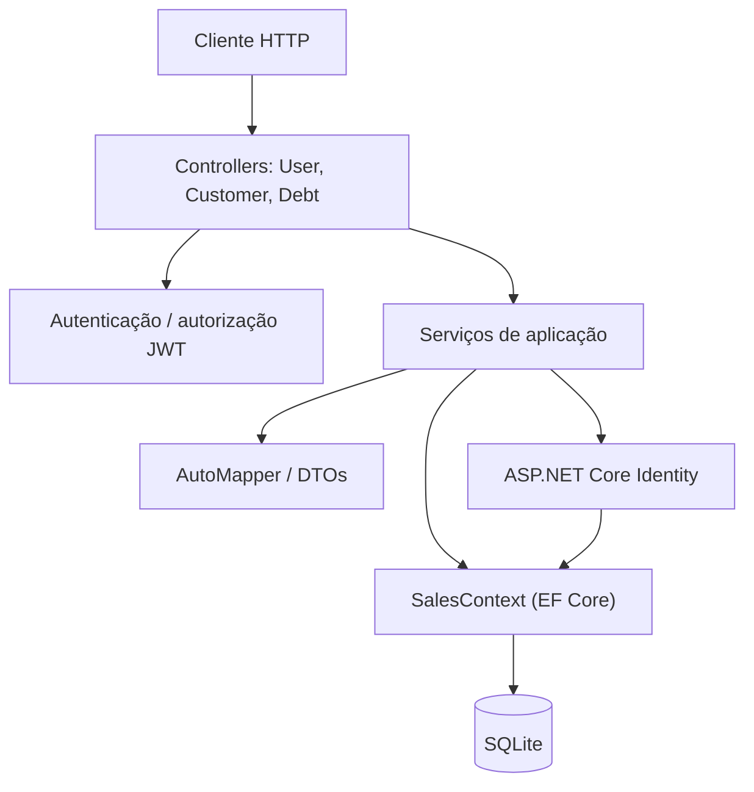
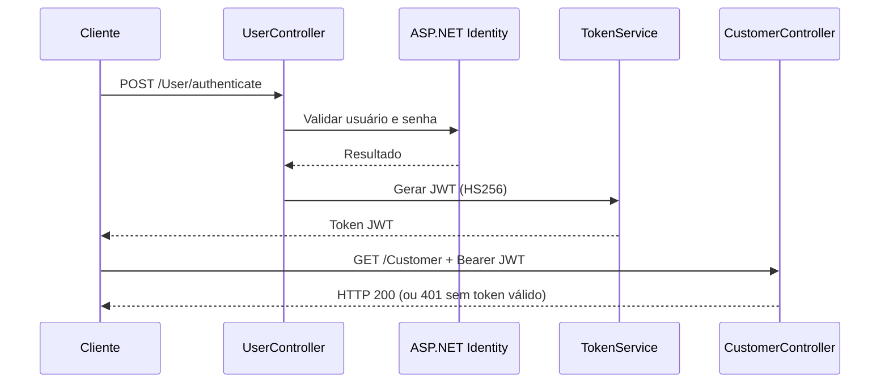

# SalesApi

API REST para cadastro de usuários, clientes e débitos, desenvolvida com **ASP.NET Core 10**, **Entity Framework Core**, **SQLite**, **ASP.NET Core Identity** e **JWT**.

Este repositório demonstra uma API organizada em controllers, serviços e camada de persistência, com autenticação, migrações de banco e testes automatizados. É um projeto de estudo/portfólio, **não uma solução pronta para produção**.

## Tecnologias

- C# / .NET 10 (ASP.NET Core Web API)
- Entity Framework Core com SQLite e migrations
- ASP.NET Core Identity e autenticação JWT (HMAC SHA-256)
- AutoMapper para transformação entre entidades e DTOs
- Swagger/OpenAPI em ambiente de desenvolvimento
- xUnit, WebApplicationFactory e SQLite isolado para testes
- GitHub Actions: build, testes e auditoria NuGet

## Arquitetura



O diagrama é uma visão lógica simplificada; o middleware de autenticação atua antes da execução dos endpoints protegidos. Veja [documentação de arquitetura](docs/ARCHITECTURE.md) para os componentes, fluxos e decisões técnicas.

## Executar localmente

Pré-requisito: **SDK .NET 10**.

```bash
git clone https://github.com/danmaciel/SalesApi.git
cd SalesApi

# O appsettings.json usa ./Database/database.db, relativo ao diretório de execução
mkdir -p Database

# Crie uma chave aleatória e mantenha-a fora do Git.
# Exemplo Linux/macOS com OpenSSL:
dotnet user-secrets set "SymmetricSecurityKey:value" "$(openssl rand -base64 48)"

dotnet restore
dotnet run
```

O aplicativo exige uma chave de assinatura JWT com pelo menos 32 bytes UTF-8. A configuração `SymmetricSecurityKey:value` também pode ser fornecida por um gerenciador de segredos ou variável de ambiente `SymmetricSecurityKey__value`. **Não reutilize** a chave presente em versões antigas do repositório.

O `appsettings.json` aponta para SQLite em `./Database/database.db`. O código executa `Database.Migrate()` durante a inicialização; a pasta do arquivo precisa existir e ter permissão de escrita. A interface Swagger é disponibilizada apenas no ambiente `Development` (normalmente `/swagger`).

## Autenticação

Os endpoints de usuário são:

| Método | Rota | Autorização |
| --- | --- | --- |
| POST | `/User` | Pública (cadastro) |
| POST | `/User/authenticate` | Pública (login, retorna token JWT) |
| GET/POST/PUT/PATCH/DELETE | `/Customer` e rotas derivadas | JWT obrigatório |
| GET/POST/PUT/PATCH/DELETE | `/Debt` e rotas derivadas | JWT obrigatório |

As rotas de leitura por ID, paginação e filtro são definidas nos controllers. Os endpoints de login retornam o token no corpo da resposta (texto), e o cliente deve enviá-lo no cabeçalho `Authorization: Bearer <token>` nos recursos protegidos.

Exemplo de fluxo:



## Testes e CI

```bash
dotnet build SalesApi.sln --configuration Release
dotnet test tests/SalesApi.Tests/SalesApi.Tests.csproj --configuration Release
dotnet list SalesApi.csproj package --vulnerable --include-transitive
```

A suíte cobre geração/validação de JWT, comportamento com chave ausente, mapeamento de clientes, migrations SQLite em memória e fluxos HTTP de cadastro, login, autorização e validação. O workflow [dotnet.yml](.github/workflows/dotnet.yml) executa build, testes e auditoria de dependências em pull requests e na `main`.

## Limitações e melhorias futuras

- O projeto atualmente utiliza uma única API e SQLite local; não implementa microsserviços, mensageria ou alta disponibilidade.
- O token JWT é emitido com validade de 30 dias, sem fluxo de refresh token/revogação.
- As consultas de débitos que usavam SQL interpolado foram substituídas por consultas LINQ no `DebtService`. Os testes de regressão cobrem os filtros relacionados a clientes e débitos pendentes. A aplicação ainda requer revisão de autorização e configuração antes de qualquer uso em produção.
- A execução automática de migrations na inicialização é prática para estudo, mas requer estratégia controlada em produção.
- Expandir os testes de regras de negócio, tratamento de erros e persistência.
- Validar configuração de HTTPS e autenticação no ambiente de implantação.

## Segurança

Valores reais de segredos não devem ser versionados. O `.gitignore` protege arquivos locais comuns, mas **não remove credenciais já publicadas no histórico**. Uma antiga chave JWT esteve presente em commits anteriores; trate-a como comprometida e faça rotação caso tenha sido usada em algum ambiente.

## Licença

Consulte o arquivo de licença no repositório.
