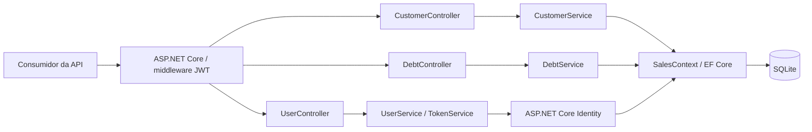
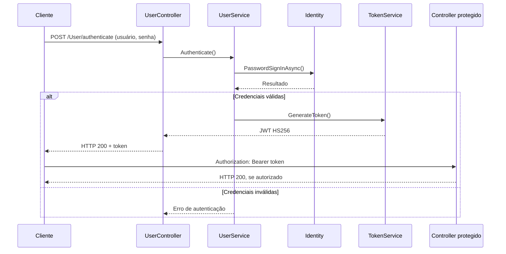
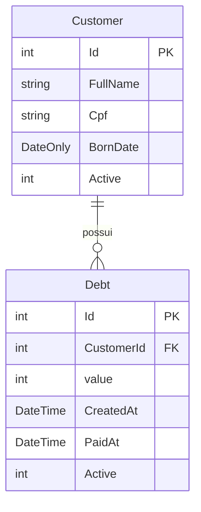

# Arquitetura — SalesApi

## Visão geral

O SalesApi é um **monólito modular simples**, não um sistema distribuído. A API concentra três responsabilidades: cadastro/autenticação de usuários, manutenção de clientes e operações com débitos. O acesso HTTP é realizado por controllers do ASP.NET Core; os serviços executam as regras e acessam `SalesContext` (EF Core / SQLite).

> As setas representam dependências lógicas. Os controllers de cliente e débito exigem autorização; as duas rotas de usuário são públicas.

## Componentes

| Componente | Responsabilidade | Código |
| --- | --- | --- |
| Controllers | Rotas HTTP, status e autorização | `src/Controllers/` |
| Services | Cadastro, autenticação e operações de domínio | `src/Services/` |
| DTOs e Profiles | Contratos de entrada/saída e mapeamento | `src/Data/Dtos/`, `src/Profiles/` |
| Identity | Armazenamento e validação de usuários e senhas | ASP.NET Core Identity |
| TokenService | Emissão de JWT assinado com HS256 | `src/Services/TokenService.cs` |
| SalesContext | DbSets, persistência e migrations | `src/Data/SalesContext.cs`, `Migrations/` |
| Testes | Testes unitários e de integração HTTP | `tests/SalesApi.Tests/` |

## Fluxo de login e autorização

O segredo é obtido de `SymmetricSecurityKey:value` pela configuração ASP.NET Core. A aplicação falha na inicialização quando não existe uma chave com pelo menos 32 bytes. A validação atual desabilita a exigência de issuer e audience e utiliza `ClockSkew = 0`: essa é uma decisão do projeto atual, **não uma recomendação genérica para produção**.

## Persistência

`SalesContext` utiliza Entity Framework Core com SQLite. A modelagem inclui `Customer`, `Debt` e as tabelas de identidade do ASP.NET Core. O modelo representa débitos associados a clientes por `CustomerId`.

O campo `Active` é usado pelos serviços em filtros e operações de exclusão lógica; a implementação não aplica esses filtros de forma uniforme em todas as consultas. As migrations são executadas pela aplicação na inicialização por meio de `DatabaseManagementService.MigrationInitialisation`.

## Testes automatizados

A suíte xUnit executada no GitHub Actions verifica:

1. Geração de JWT, assinatura e claims, além da falha com chave ausente.
2. Mapeamento de `CreateCustomerDto` para `Customer`.
3. Criação do esquema SQLite via migration em memória.
4. Integração HTTP com `WebApplicationFactory`: cadastro, login, acesso protegido, requisição anônima e rejeição de dados inválidos.

Os testes HTTP utilizam uma base SQLite temporária e chave de teste. Eles não equivalem a testes completos de segurança ou de todos os fluxos de negócio.

## Decisões e riscos

| Aspecto | Implementação atual | Avaliação |
| --- | --- | --- |
| Implantação | API única e SQLite local | Simples de executar; sem escalabilidade horizontal pronta |
| Segurança | ASP.NET Core Identity e JWT | Exigir HTTPS e gestão/rotação de segredos em implantação |
| Tokens | HS256, validade de 30 dias | Revisar expiração, revogação, issuer/audience para produção |
| Consulta a débitos | `FromSqlRaw` com interpolação de IDs | Substituir por LINQ ou SQL parametrizado |
| Migrations | Executadas no startup | Preferir processo de implantação controlado em produção |
| Exclusão lógica | Campo `Active` | Rever consistência de filtros em todas as consultas |
| CI | Build, xUnit e auditoria de pacotes | Acrescentar cobertura e verificações funcionais adicionais |

## Evolução sugerida

Priorizar remoção de SQL interpolado, reforço de validações e regras de domínio, cobertura de testes e política de autenticação antes de considerar modularização adicional ou novas tecnologias. O objetivo é manter decisões justificadas pelo tamanho e pelas necessidades do projeto.
